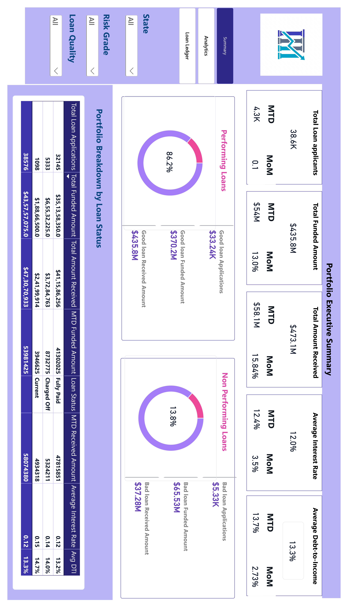
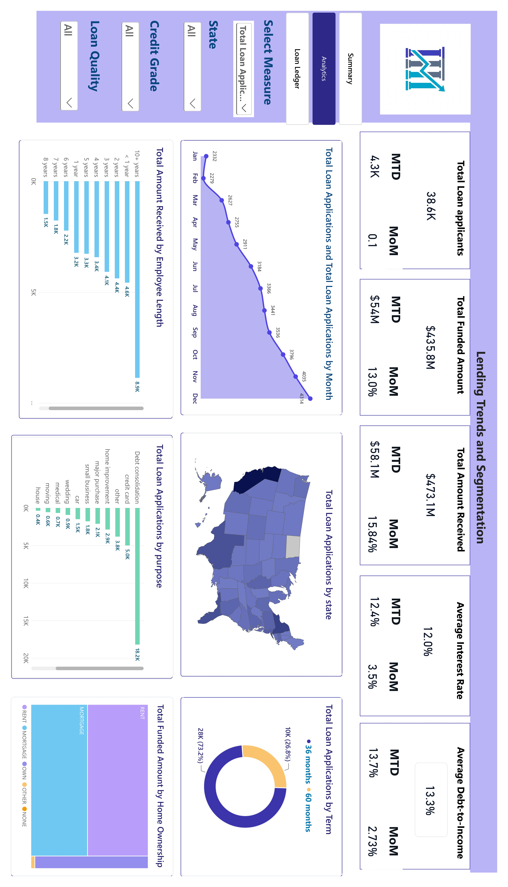
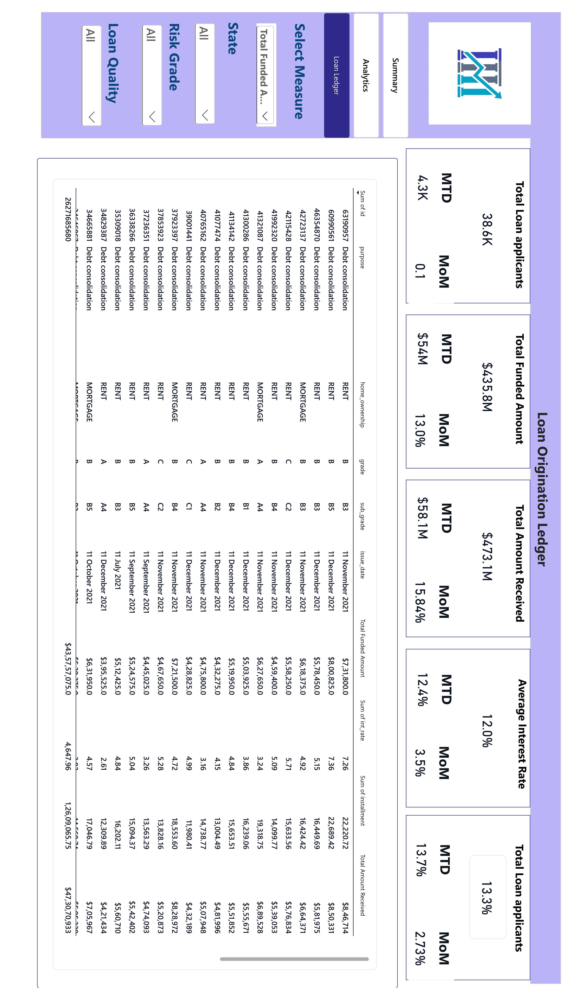

# 🏦 Bank Loan Portfolio & Risk Analytics Dashboard (SQL + Power BI)


## 📌 Project Overview
This end-to-end Business Intelligence project analyzes **38,576 bank loan records** across **50 U.S. states** (Jan–Dec 2021) to monitor lending activity, assess credit risk, and evaluate portfolio health. All dashboard KPIs and aggregations built in **Power BI (DAX & Power Query)** are independently cross-validated against **SQL Server (T-SQL)** queries to ensure 100% reporting accuracy.

📄 **[View Static PDF Report](powerbi/Bank%20Loan%20BI%20Dashboard.pdf)** | 💻 **[Download Power BI File (.pbix)](powerbi/Bank%20Loan%20BI%20Project.pbix)** | 🗄️ **[View SQL Validation Script](sql/SQLQuery%20bank%20loan%20portfolio.sql)**

---

## 📊 Executive KPI Summary

| Metric | Overall (2021) | MTD (Dec 2021) | PMTD (Nov 2021) | MoM Growth |
| :--- | :---: | :---: | :---: | :---: |
| **Total Loan Applications** | 38,576 | 4,314 | 4,035 | **+6.91%** |
| **Total Funded Amount** | $435.76M | $53.98M | $47.75M | **+13.04%** |
| **Total Amount Received** | $473.07M | $58.07M | $50.13M | **+15.84%** |
| **Average Interest Rate** | 12.05% | 12.36% | 11.94% | **+3.47%** |
| **Average DTI (Debt-to-Income)** | 13.33% | 13.67% | 13.30% | **+2.73%** |

### Good Loans vs. Bad Loans Breakdown
| Portfolio Segment | Loan Status | Applications | % of Total | Funded Amount | Amount Received |
| :--- | :--- | :---: | :---: | :---: | :---: |
| **Good Loans** | Fully Paid, Current | 33,243 | **86.18%** | $370.22M | $435.79M |
| **Bad Loans** | Charged Off | 5,333 | **13.82%** | $65.53M | $37.28M |

---

## 🖥️ Dashboard Architecture (3 Interactive Pages)

### 1. Summary Dashboard
* High-level executive KPI cards displaying **Total, MTD, and MoM** performance.
* **Good Loan vs. Bad Loan** donut charts and breakdown cards.
* **Loan Status Grid View** comparing Funded Amount, Received Amount, Interest Rate, and DTI across `Fully Paid`, `Current`, and `Charged Off` loans.



### 2. Overview Dashboard
* **Monthly Trends (Line Chart):** Tracks seasonal growth in applications, funded volume, and repayments across 2021.
* **Regional Analysis (U.S. Shape Map):** Highlights lending concentration across all 50 states.
* **Borrower Segmentation:** Donut chart by **Loan Term**, horizontal bar charts by **Employment Length** and **Loan Purpose**, and a treemap by **Home Ownership**.



### 3. Details Dashboard
* Granular tabular report enabling stakeholders to drill down into individual borrower records using dynamic slicers (State, Grade, Loan Status, Purpose).



---

## 🔍 Key Business Insights
* **Strong Portfolio Profitability:** Total repayments ($473.07M) exceed total disbursements ($435.76M), driven by an **86.18% Good Loan rate**.
* **Higher Risk Profile in Defaults:** Charged-off loans carry a noticeably higher average interest rate (**13.88%**) and DTI (**14.00%**) compared to fully paid loans (**11.64%** interest rate, **13.17%** DTI).
* **Primary Borrowing Purpose:** **Debt Consolidation** dominates the portfolio (**18,214 applications / 47.2%**), followed by **Credit Card refinancing (4,998)**.
* **Loan Term & Demographics:** **73.2%** of borrowers opt for **36-month terms** over 60-month terms (**26.8%**); **California (6,894)**, **New York (3,701)**, **Florida (2,773)**, and **Texas (2,664)** lead regional demand, and borrowers with **10+ years of employment** form the largest tenure segment (**8,870**).

---

## 🛠️ Tech Stack & Methodology
* **Database & Validation:** Microsoft SQL Server (T-SQL) — `CASE WHEN`, `DATENAME`, `MONTH`/`YEAR` filtering, `GROUP BY` aggregations.
* **BI & Visualization:** Power BI Desktop — Power Query (ETL), Date Table modeling, DAX Time-Intelligence (`TOTALMTD`, `PREVIOUSMONTH`, MoM %), dynamic slicers, and custom page navigation.
* **Dataset:** `financial_loan.csv` (38,576 rows × 24 columns).

---

## 📂 Repository Structure
```text
├── data/
│   └── financial_loan.csv                     # Raw loan dataset (38,576 records)
├── images/
│   ├── img1.jpg                               # Summary Dashboard screenshot
│   ├── img2.jpg                               # Overview Dashboard screenshot
│   └── img3.jpg                               # Details Dashboard screenshot
├── powerbi/
│   ├── Bank Loan BI Project.pbix              # Interactive Power BI report file
│   └── Bank Loan BI Dashboard.pdf             # Static PDF export of all 3 pages
├── sql/
│   ├── SQLQuery bank loan portfolio.sql       # T-SQL queries for KPI & segment validation
│   └── SQLQuery2 bank loan portfolio.sql      # Quick table inspection query
└── README.md                                  # Project documentation
